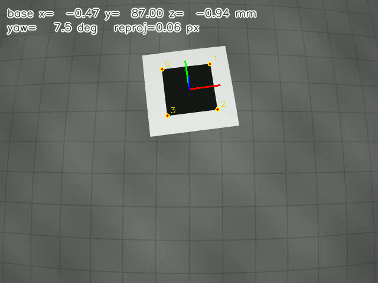
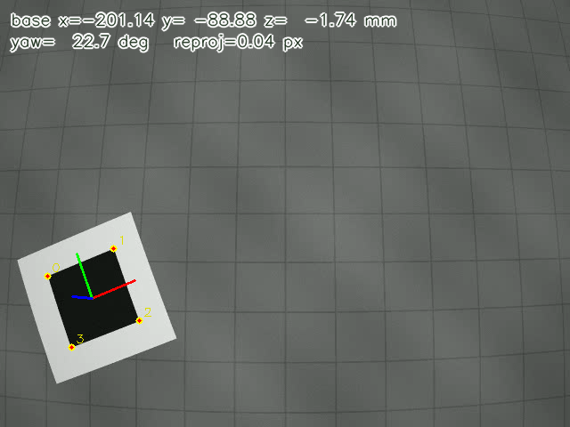

# 工创实验室视觉第四章任务书：接手识别代码，补上位姿并修好遗留问题

## 任务目标

- 掌握在既有代码里找到合适接入点、自己定义输入输出契约并把新功能接进去的方法
- 掌握相机内参与畸变模型的使用，能说清像素坐标到归一化坐标的换算
- 掌握由旋转矩形取角点、角点顺序约定，以及用 `solvePnP` 求出靶标相对相机的位姿
- 掌握手眼变换与重投影验证，能把像素结果换算到机械臂基坐标并自行核对

## 学习目标与范围

本章不是从零写功能，也不是单纯改 bug：上一届交接下来的项目只做到“认出靶标矩形”，位姿部分没有留下。你要先读懂别人的识别代码、找到该接入的位置，自己设计一个位姿求解函数或类，把结果供给已有的画面与 JSON 输出；此外还有三条遗留工单要修。核心能力是**读别人的代码、定接口、把新功能接进既有流程**，以及把靶标从图像像素换算到机械臂基坐标的完整位姿链路。

- **必做**：① 补上靶标位姿求解（新增代码，结果满足验收指标）；② 修复 `故障工单.md` 中 A-01、A-02、A-03 三条问题。完成后程序在 240 帧测试视频上稳定输出抓取点与偏航角，输出视频可正常播放。
- **新知识**：相机内参与畸变、平面四点 PnP、手眼变换、重投影验证；以及给既有代码加功能时的接口设计（输入输出契约、单位与坐标系、失败返回）。
- **不要求**：重写靶标检测、训练模型、真实机械臂、GPU、开发板部署。全章 CPU 即可完成。
- **与已发材料的关系**：前几章和直通车的参考代码可以复用读帧、绘图、保存、`imshow` 循环等通用部分；本任务的位姿链路（内参、PnP、坐标系、单位）是新内容，照搬旧代码不能完成。

## 背景

工位相机固定在机械臂基座附近，俯视桌面。程序要检测桌面上边长 80mm 的黑色方形靶标，求出它在机械臂基坐标系下的位置与偏航角，供抓取使用。这个项目由上一届交接而来：识别部分已经写好，但交接代码在当前 OpenCV 版本下**直接跑不起来**，**位姿部分也完全没有**（`results.json` 里对应字段是 `null`）。`故障工单.md` 记录了接手时确认存在的三条工程问题。

项目文件、素材和参考输出都在同章 `任务项目/` 目录中。`README.md` 说明如何运行，`data/target_spec.md` 给出尺寸、单位和坐标系约定。

## 任务要求

### 1. 补上靶标位姿求解

现有代码的 `detector.detect_target()` 给出靶标的旋转矩形（`((cx, cy), (w, h), angle)`，单位为像素）和轮廓点集。请在此基础上补出位姿链路：

- 由矩形得到四个角点，按约定顺序与靶标三维点表对应（顺序约定见 `data/target_spec.md`，靶标边长 80mm，本任务统一用毫米）；
- 调用 `solvePnP` 解出靶标在相机坐标系下的位姿（平面四点建议 `SOLVEPNP_IPPE`）；
- 用 `data/handeye.yaml` 里的 `T_base_cam` 换算到机械臂基坐标，并算出偏航角（`camera.py` 已提供 `CameraModel.from_file()` 和 `load_handeye()`，直接调用即可，不用自己解析 YAML）；
- 用重投影误差做自洽检查。

接入要求（这几条是评分点，不是建议）：

- 位姿计算要封装成可复用的函数或类：视频主循环和单帧调试调用同一份实现，不要把公式内联在循环里写两遍。
- 函数或类的输入输出、单位、坐标系写进 docstring；返回值要能直接喂给现有输出——终端一行、`results.json` 的四个位姿字段、画面上的坐标轴。
- 检测不到靶标时不能崩溃：给出明确返回（`None`、标志位或异常），主循环继续写视频并统计 `lost`。
- 允许新增文件、允许改 `main.py` 的调用方式，但不得修改 `data/` 与 `expected/`，也不得改变 `detect_target()` 的返回语义（不能让它直接返回位姿）。

两个最容易踩的坑，本版不再作为既有缺陷，而是新代码自己可能引入的错误，验收时按现象扣分：

| 现象 | 典型原因 |
| --- | --- |
| 画面中间的靶标准、移到画面边缘明显偏，坐标轴贴不住 | `solvePnP` / `projectPoints` 没传畸变系数（传了 `None`） |
| 抓取点 z 在 500 左右，画面上坐标轴长到离谱 | 三维点表用了米，而内参与手眼矩阵是毫米，1000 倍混用 |

### 2. 修复三条工单问题

逐条复现、定位、修复。工单只写现象，不指出代码位置；请自己建立“现象 → 假设 → 验证 → 结论”的记录。

> 编号说明：原 `故障工单.md` 共 6 条。本版取 3 条：A-01、A-02 是识别与输出环节的工程问题，A-03 是“把检测到的矩形画到画面上”这一步的尺寸换算问题。

修复后应达到：

| 编号 | 现象 | 修复后应达到 |
| --- | --- | --- |
| A-01 | `python main.py` 第一帧就抛 `ValueError: not enough values to unpack (expected 3, got 2)`，`output.avi` 和 `results.json` 都没有生成 | `python main.py` 能正常跑完 240 帧，终端每帧输出检测结果（此时视频可能仍是坏的，那是 A-02） |
| A-02 | `output.avi` 只有几 KB、打不开 | 输出视频可播放，帧数不少于 240 |
| A-03 | 画出来的框中心、朝向都对，但四条边都在靶标外面，框比靶标大了一整圈 | 框的四条边与靶标贴合，框边长与 `results.json` 里的 `rect_size_px` 相差不超过 2px |

要求：

- 一次只改一个因素，改前记录当前现象；修好一条再做下一条。
- 不能靠删除功能、用 `try/except` 吞掉异常或改小验收标准来“通过”。
- 不得修改 `data/` 下的素材、内参、手眼矩阵和 `expected/` 样例；这些是共同验收依据。

### 3. 交付可验证的结果

运行 `python main.py` 后应生成：

- `output.avi`：带坐标轴、角点、重投影点和数值标注的处理后视频；
- `results.json`：逐帧的相机系位置、基座标位置、偏航角和重投影误差（即现在为 `null` 的四个字段）。

验收指标（阈值由来：用“旋转矩形 → 四个角点 → `SOLVEPNP_IPPE`”这条链路在整段测试视频上实测，最坏误差再放宽 1.2 倍得到；`expected/` 的样例来自亚像素参考实现，所以允许十几毫米的 `z` 系统差）：

1. 240 帧全部检测到靶标（`lost` 为 0）；
2. 每帧重投影误差 < 1.5px；
3. 靶标平放时基坐标 `z` 每帧都在 ±22mm 内；
4. 第 0、120 帧与 `expected/终端输出样例.txt` 相比：水平方向（x、y）差 ≤ 4mm，`z` 差 ≤ 12mm，偏航角差 ≤ 3.5°；
5. 输出视频帧数不少于 240，可正常播放；
6. 画面上画的框必须与检测结果一致：框的边长与 `results.json` 里的 `rect_size_px` 相差不超过 2px，框的四条边要贴着靶标，不允许出现“框比靶标大一倍”这类画法与数据不符的情况。

第 2～4 条是“用旋转矩形取角点”这条通路的合格线；在此之上再做亚像素细化，可以冲加分项里的严格线（±5mm、±2°）。

上面是**整体验收指标**，需要新功能和三条工单都完成才全部满足；只做了一部分时，部分指标可能仍不达标，这是正常的，不要为了“让某一项先达标”去改公式或改素材。

### 4. 写排查记录

新建 `排查记录.md`，每条工单对应一节，包含：

```text
## 工单 A-0x
- 现象：我看到的实际表现（附终端输出或截图路径）
- 复现步骤：命令、输入、出现的帧号
- 假设与验证：至少写出尝试过的 1～2 个假设，以及用什么方法验证、结果如何
- 根因：具体到文件、函数和那一处逻辑
- 修复：改了什么，为什么这样改
- 验证：修复前后同一输入的结果对比
- 回退预测：如果把修复改回去，会重新看到什么现象
```

另加一节「接口说明」，写清：

```text
## 接口说明
- 位姿函数/类放在哪个文件、叫什么，为什么放在这里
- 输入：角点的形状与单位、用到哪些外部参数
- 输出：返回什么、单位与坐标系是什么、失败时返回什么
- 主循环怎么调用它，单帧调试怎么复用同一份实现
- 为了接入它，改了既有代码的哪些地方，为什么必须改
```

记录允许包含走不通的假设。只写“改了某行就好了”的条目，按未完成定位计分。

## 提交清单

将作业打包为 `视觉第四章作业 姓名.zip`，邮件主题写 `视觉第四章作业-姓名`。邮件地址和截止时间以发布通知为准。

```text
视觉第四章作业 姓名/
├── 修复后项目/
│   ├── main.py
│   ├── camera.py
│   ├── detector.py
│   ├── output.py
│   ├── pose.py               # 你新增的位姿模块，文件名可自定
│   ├── results.json
│   ├── output.avi
│   ├── data/                 # 原样复制，不得修改
│   └── expected/             # 原样复制，不得修改
├── 排查记录.md               # 含「接口说明」一节
├── 验证/
│   ├── 关键帧_修复后.png      # 第 0 帧或第 120 帧
│   └── 边缘帧_修复后.png      # 第 180 帧
├── git_log.txt               # 新增功能、每处修复各提交一次后的 git log --oneline
└── 问题记录.txt               # 可选
```

要求：

- 项目目录内初始化 git，**新增功能和每修一个缺陷各提交一次**，提交信息写清对应功能点或工单编号；`git_log.txt` 用 `git log --oneline` 生成。
- 代码保留必要的注释：函数用途、输入输出、单位与坐标系、关键判断的原因。不要逐行翻译简单语句。
- 不要提交 `__pycache__`、临时脚本或多个无法判断版本的“最终版”文件。
- 使用了 Agent 的，在排查记录末尾用一小节说明：哪些环节用了、采纳了什么建议、自己如何验证；未使用也如实写明。

## 验收样例

`任务项目/expected/` 提供：

- `终端输出样例.txt`：第 0 帧和第 120 帧的参考输出，由亚像素参考实现生成。比对容差见验收指标第 4 条；其余帧不提供答案。
- `关键帧示意.png`：完成后的画面形式（坐标轴、角点编号、重投影点）。
- `边缘帧示意.png`：靶标位于画面边缘时的正确结果，用于对比“畸变没传”这类错误。

下图仅用于核对结果方向，不是逐帧答案：





## 示例使用边界

| 来源 | 本任务中的用法 |
| --- | --- |
| 前几章与直通车的参考代码 | 读帧、绘图、保存、循环结构可直接复用；位姿与坐标变换部分不能照搬。 |
| 网上教程与官方文档 | 用于查函数参数和公式；以当前安装版本的 OpenCV 文档和实际运行结果为准。 |
| Agent | 允许使用。需要能解释它给出的判断，并用实际运行结果验证；不能把未验证的修改直接当作完成。 |
| `data/` 素材、内参、手眼矩阵、`expected/` | 只读。改这些等于改考题，评阅时按 0 分处理。 |

## 加分项（自愿，最多 10 分）

1. **亚像素角点（3 分）**：在 `detector` 给出的轮廓上做亚像素细化或边缘拟合求交，把第 0、120 帧的偏差压到水平 ±5mm、`z` ±8mm、偏航角 ±2°，并给出开启前后 `z`、偏航角和重投影误差的定量对比。
2. **自主标定（4 分）**：用 `data/calibration.mp4` 自己标定（`findChessboardCorners` + `calibrateCamera`），给出内参、畸变系数和 RMS 重投影误差，与 `calibration.yaml` 对比，并用自己标定的结果重跑位姿、说明差异。
3. **稳定输出（3 分）**：对位姿做合理平滑，或处理检测不到的帧（不崩溃、给出丢失标记、恢复后继续），用前后指标说明改进。

加分项不完成不影响基础分。

## 答辩、求助与修改

线下答辩时展示修复后的代码、排查记录和运行结果，重点解释：

- 你的位姿函数是怎么定契约的，为什么接在这个位置而不是别处；
- 由矩形取角点时顺序错了会看到什么现象（正方形有 90° 旋转对称性）；
- 重投影误差小是否一定说明位姿正确（结合“边缘偏”和“z 数量级”两个例子回答）；
- 改一个参数（例如把靶标边长当成 100mm）会对结果产生什么影响。

现场可能要求：随机回退一处修复并预测现象；给一段没见过的代码或换一段素材，当场定位问题。

求助时按“目标、环境、运行命令、预期与实际、完整报错、已尝试的检查”组织信息，附必要代码和文件。首次评价后有一次修改机会，修改稿附 `修改说明.md`，列出改动、原因和验证结果；具体时间以发布通知为准。
